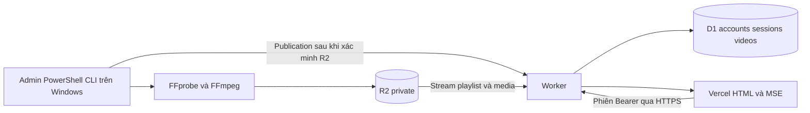
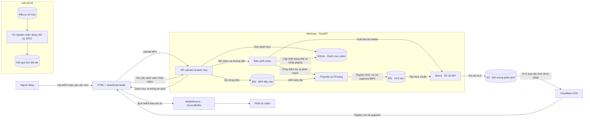
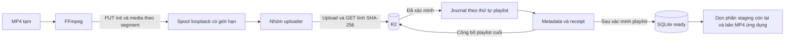

# Kiến trúc HLS Binary Cloud Streaming

## Kiến trúc hiện hành · Phase 08 Addition

Một site tĩnh trên Vercel gọi Worker qua HTTPS. Worker kiểm phiên và role trong D1 trước khi trả danh mục, playlist hoặc stream R2. Admin vẫn quản lý User bằng site khi máy Windows dừng. Companion chỉ được chạy khi xử lý, xác thực Admin qua Worker và công bố qua credential dịch vụ riêng. Các mô tả hệ thống sau phần này ghi lại thiết kế các Phase trước.

SQLite local chỉ phục vụ khôi phục tác vụ và gắn nguồn chính xác để dọn. D1 lưu khóa playlist và prefix bất biến; khóa của Phase cũ được nhập bằng `import-ready`. Query danh mục D1 dùng index trạng thái/thời gian/UUID và cursor. Worker dùng tombstone DELETED để chặn công bố lại UUID đã xóa và trạng thái DELETING trong lúc dọn prefix. R2 giữ media chuẩn cùng metadata HLS. `library.json` cũ có thể tiếp tục tồn tại dưới dạng lịch sử; hệ thống online hiện hành dùng D1.

## Phạm vi triển khai

FastAPI trên Windows nhận MP4 theo luồng, ghi trạng thái qua SQLite và dùng worker FFmpeg để tạo HLS fMP4. Backend lưu và xác minh bộ HLS trên R2. Thư viện SQLite ghi metadata để mở lại video theo UUID sau khi khởi động lại. Trình phát JavaScript tải media từ CDN hoặc route đọc bucket riêng và đưa từng đoạn vào MSE. Xem [trình phát MSE](MSE.md), [R2 và CDN](R2_CDN.md), [HLS](HLS.md) và [lab nhị phân](BINARY_PROCESSING.md).

## Sơ đồ luồng dữ liệu

## Luồng ingest, xuất bản và phát lại

1. FastAPI nhận MP4 và ghi theo khối vào thư mục upload. API đếm byte thực nhận để áp dụng `HLS_MAX_UPLOAD_BYTES`. Thời lượng và số segment được xác định từ đầu vào. SQLite lưu trạng thái và đường dẫn playlist.
2. FFprobe đọc container và thông tin stream từ tệp cục bộ. FFmpeg ghi HLS VOD ra đĩa dưới dạng playlist `.m3u8`, init segment `.mp4` và các segment `.m4s`. Kiến trúc chọn fMP4 để trình duyệt có thể đưa byte stream ISO BMFF vào MSE sau khi xác nhận codec phù hợp. [FFmpeg HLS muxer](https://ffmpeg.org/ffmpeg-formats.html#hls-2) · [W3C ISO BMFF Byte Stream Format](https://www.w3.org/TR/mse-byte-stream-format-isobmff/).
3. Boto3 chuyển từng tệp HLS từ đĩa lên R2 qua S3 API. Tiền tố `videos/<UUID>/` giữ init segment, media segment, metadata và playlist. Ghi playlist sau cùng và chỉ đánh dấu `ready` khi đã đọc lại, xác minh SHA-256 của toàn bộ object. R2 là nơi đọc bản HLS đã xuất bản. MP4 nguồn giữ trong thư mục upload cục bộ. [Cloudflare R2 với Boto3](https://developers.cloudflare.com/r2/examples/aws/boto3/).
4. `GET /api/videos` đọc metadata có phân trang từ SQLite. Với video `ready` trên R2, lượt gọi `GET /api/videos/{video_id}/playback` dùng object key đã lưu và cấu hình hiện tại để trả URL playlist cùng codec. CDN phục vụ đúng loại nội dung HLS. Khi frontend có origin khác, cấu hình CORS cho origin đó. [R2 public buckets](https://developers.cloudflare.com/r2/buckets/public-buckets/) · [R2 CORS](https://developers.cloudflare.com/r2/buckets/cors/) · [Điều khoản CDN Cloudflare](https://www.cloudflare.com/service-specific-terms-application-services/).
5. JavaScript đọc playlist, kiểm tra MIME và codec qua `MediaSource.isTypeSupported()`, tải init segment rồi nối từng media segment bằng `SourceBuffer.appendBuffer()`. Chờ `updateend` giữa các lần nối và giữ cửa sổ đệm hữu hạn để phát video dài với mức sử dụng bộ nhớ ổn định. [W3C Media Source Extensions](https://www.w3.org/TR/media-source-2/).

Lab JPEG làm việc với bản sao dữ liệu tự sở hữu để quan sát sự khác nhau giữa nhận dạng qua chữ ký và cấu trúc hợp lệ của tệp. Mẫu và kết quả ở trên đĩa lab. Luồng phân phối dùng playlist và phân đoạn HLS chuẩn với loại nội dung mô tả đúng dữ liệu.

## Trách nhiệm module

| Đường dẫn | Trách nhiệm |
| --- | --- |
| `backend/main.py` | Điểm vào ASGI. Khởi tạo thư mục dữ liệu và SQLite trong FastAPI lifespan. Đăng ký router, Swagger, OpenAPI và trang HTML. |
| `backend/config.py` | Nạp `.env`, áp dụng biến môi trường ưu tiên hơn, chuẩn hóa đường dẫn dữ liệu và kiểm tra giới hạn upload. |
| `backend/database.py` | Migration bảng `videos`, truy vấn danh mục và lưu metadata, trạng thái, khóa R2 trước khi dọn tệp tạm. |
| `backend/api/` | `health.py` kiểm tra SQLite. `uploads.py` nhận MP4 theo luồng và phục vụ đường dẫn cũ. `videos.py` cung cấp thư viện, upload, metadata, trạng thái và URL phát theo UUID. |
| `backend/services/` | `upload_service.py` ghi upload theo luồng và điều phối worker theo hàng đợi SQLite. |
| `backend/processing/` | FFprobe đọc thông tin MP4, FFmpeg tạo HLS và `hls_generator.py` tính metadata cùng SHA-256. |
| `backend/binary/` | Đọc marker JPEG và box fMP4, đối chiếu chữ ký với tên tệp và MIME, đóng gói HLSLAB và xác minh dữ liệu khôi phục. |
| `backend/storage/` | Kết nối S3 qua Boto3, upload và xác minh HLS, đọc object từ R2 và CLI kiểm tra. Credential lấy từ môi trường hoặc `.env`. |
| `frontend/` | Trang HTML tối thiểu để upload, xem trạng thái và phát theo Video ID. Các module JavaScript xử lý playlist, Fetch, SourceBuffer và lab byte cục bộ. |
| `data/` | Các vùng lưu MP4 đầu vào, HLS tạm và danh mục SQLite trên đĩa. |
| `tests/` | Smoke test PowerShell chạy HTTP qua Uvicorn thật. |

### Danh mục SQLite

`videos.id` là UUID do backend cấp. `title` lấy từ tên tệp gốc. `original_filename`, `original_size` theo byte, `duration` theo giây, `segment_count` và `created_at` phục vụ thư viện. `status` nhận `uploaded`, `processing`, `ready` hoặc `failed`. Video trên R2 giữ `playlist_key`, `r2_prefix`, `codecs`, bucket và endpoint. Cơ sở dữ liệu giữ khóa đối tượng và metadata. URL phát được tính lúc yêu cầu.

Migration thêm cột vào bảng hiện có và giữ nguyên UUID. Worker bổ sung metadata cũ từ manifest cục bộ hoặc `metadata.json` đã xác minh trên R2. Trường chưa xác định được từ nguồn cũ có thể là `null`. Với video mới, kiểm tra object trên R2 hoàn tất trước khi một giao dịch SQLite ghi `ready`, metadata và dấu `cleanup_pending`. Sau commit, worker mới dọn HLS tạm nếu đã bật cấu hình.

## Phase 07 · Storage chính trên R2

Phần mô tả pipeline batch phía trên áp dụng cho HLS cục bộ và chế độ đối chiếu. Job R2 mới dùng streaming theo mặc định. Xem [vòng đời dữ liệu và Playback After Restart](CLOUD_FIRST_STORAGE.md), [backpressure](LARGE_FILE_OPTIMIZATION.md), [trình tự giao dịch R2](CLOUDFLARE_R2.md) và [dọn tệp](LOCAL_CLEANUP.md).

Storage HLS mới có thêm UUID lần xử lý trong prefix. SQLite lưu `processed_size` và `init_key` cùng object key playlist. FastAPI dựng URL hiện hành khi người xem mở video. MSE nhận giới hạn bộ đệm từ API, giữ trình tải tuần tự và chuyển mục tiêu tải khi tua. Module JPEG/HLSLAB tiếp tục dùng dữ liệu nội bộ riêng.

## Bổ sung Phase 07 · Chất lượng và thư viện lớn

Worker chọn copy hoặc encode độc lập cho video và audio chính. SQLite giữ SHA-256 của MP4 đã nhận và ghi chú quyết định xử lý. Client thư viện lấy từng trang bằng `next_cursor` dựa trên cặp `(created_at, id)`. SQLite dùng chỉ mục ghép theo thứ tự đó; UUID phân biệt các video tạo cùng thời điểm. Khi có video mới thêm vào đầu danh sách, cursor của lượt xem đang mở tiếp tục từ hàng cuối đã đọc. API còn nhận phân trang offset cho client cũ. Media và playlist chỉ được tải khi người dùng mở video. [SQLite Row Values](https://www.sqlite.org/rowvalue.html#scrolling_window_queries).
