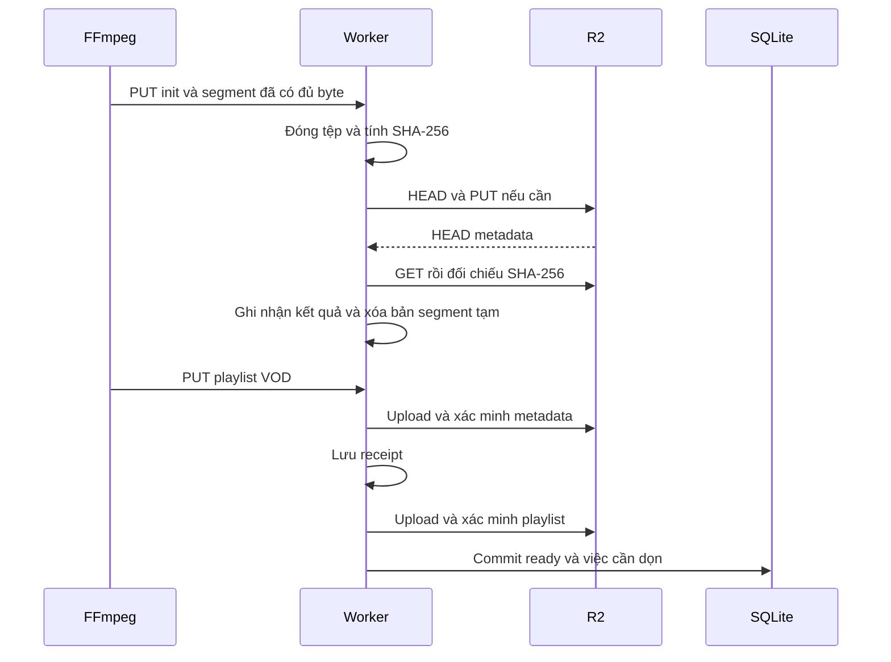

# Cloudflare R2 trong pipeline Phase 07

Thiết lập bucket, credentials, custom domain, CORS và cache theo [R2_CDN.md](R2_CDN.md). Cấp quyền đọc và ghi object trên đúng bucket để pipeline có thể PUT, HEAD, GET và dọn các lần xử lý chưa công bố bằng LIST/DELETE. Với bucket riêng, URL playback dùng proxy hiện có của FastAPI. Với custom domain công khai, trang phát tải media trực tiếp từ CDN.

Khóa cũ giữ dạng `videos/<video-id>/<filename>`. Pipeline Phase 07 dùng `videos/<video-id>/<attempt-id>/<filename>`. UUID lần xử lý ngăn hai lần encode dùng chung khóa bất biến. Sau khi video ready, SQLite giữ nguyên khóa của lần công bố thành công và dùng nó sau restart. Các URI playlist là tên tệp tương đối cùng prefix.

Boto3 tái sử dụng một client và pool kết nối. Mỗi thread gửi một object tại một thời điểm. Boto3 Transfer Manager tự dùng multipart từ ngưỡng 8 MiB của classic transfer với các part tuần tự trong từng object. Worker retry lỗi mạng, 408, 429 và lỗi 5xx với exponential backoff và giữ nguyên khóa cho object đang thử lại. SDK cũng có retry cấp request. Một upload multipart đang dở do tiến trình bị tắt có thể còn trên R2 cho tới khi lifecycle của bucket abort nó. Xem [TransferConfig của Boto3](https://docs.aws.amazon.com/boto3/latest/reference/customizations/s3.html) và [lifecycle R2](https://developers.cloudflare.com/r2/buckets/object-lifecycles/).

Dùng SHA-256 đọc theo khối tại máy. HEAD kiểm kích thước, metadata SHA, Content-Type và Cache-Control. GET tải theo khối và tính lại SHA-256 của nội dung lưu trên R2, phát hiện cả object có metadata đúng nhưng byte sai. Với cùng key và nội dung đã có, hệ thống đọc để xác minh rồi bỏ qua PUT. ETag không tham gia quyết định toàn vẹn. Đọc lại toàn bộ làm tăng số lượt gọi và lưu lượng so với chỉ HEAD.

