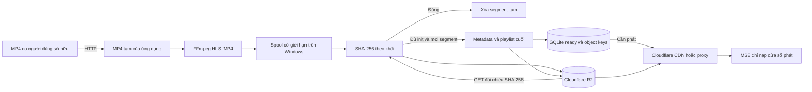
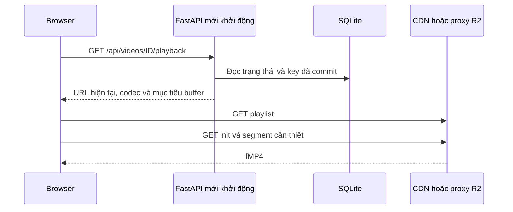

# Vòng đời dữ liệu cloud-first

Trình nhận dùng cổng loopback ngẫu nhiên và một token URL của job. HTTP chunk cuối báo file đã được FFmpeg gửi đủ. File đóng trước khi được đưa cho uploader. Journal ghi kết quả xác minh theo thứ tự phân đoạn. Worker đọc nối tiếp journal và playlist, đối chiếu toàn bộ tên phân đoạn, xác nhận init và ENDLIST, tạo metadata rồi upload playlist cuối cùng. SQLite chỉ chuyển ready khi xác minh playlist xong. Với bucket công khai, một client biết chính xác UUID lần xử lý có thể truy cập object riêng lẻ đã gửi trước thời điểm playlist được công bố.

Ở mặc định cloud-first, media tồn tại lâu dài trên R2. Mỗi tệp do ứng dụng nhận hoặc sinh ra trên Windows có thể dọn qua luồng xác minh và commit. SQLite giữ object key, kích thước nguồn, kích thước bộ HLS trên R2, thời lượng, số đoạn, init key và trạng thái. Bản ghi cũ và đường phát tương ứng được giữ tương thích.
