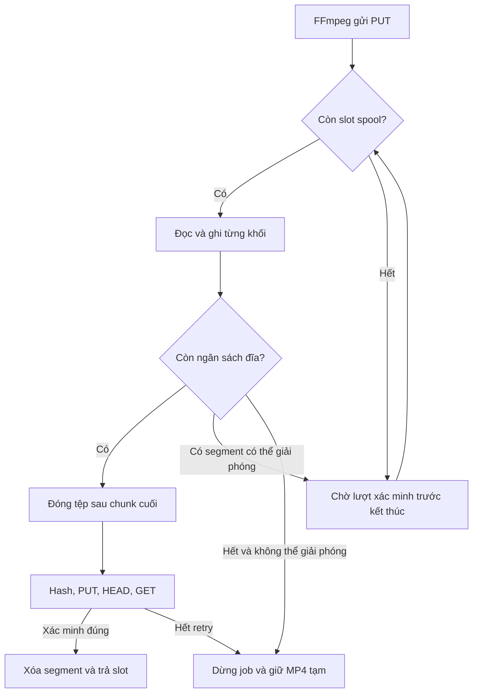

# Tối ưu MP4 nhiều GB

Trình duyệt gửi đối tượng File qua Fetch. Backend chấp nhận có Content-Length hoặc HTTP chunked. Nó kiểm tra kích thước khai báo và dung lượng đĩa trước khi ghi. Khi nhận body, backend đếm byte thực tế và ghi theo các khối đến `UPLOAD_CHUNK_SIZE_MB`. Mức trống đĩa được kiểm tra trước từng lần ghi. MP4 chỉ xuất hiện trong hàng đợi sau khi đã ghi hết, flush và đổi tên từ .part. Khi kết nối bị cắt, request xóa .part. Tiến trình chết có thể để lại UUID.part hoặc UUID.mp4 chưa có bản ghi. Worker quét các tệp mồ côi cũ trên 24 giờ khi khởi động.

Với HTTP hiện tại, client gửi lại từ đầu nếu chưa nhận UUID. Resumable Upload theo byte cần giao thức session và offset. Tệp MP4 tạm đã hoàn chỉnh thì worker có thể retry qua lệnh CLI mà không cần người dùng gửi lại. Với MP4 cùng máy, hướng khả thi để tránh bản sao là CLI riêng nhận đường dẫn tuyệt đối do chủ máy nhập, mở chỉ đọc và giữ nguyên tệp trong lúc xử lý. Tài liệu xem đây là phương án nghiên cứu. Trình duyệt thông thường chỉ chuyển byte của File.

Khi đầy slot, trình nhận tạm ngừng đọc socket. TCP điều tiết tiến trình FFmpeg. FFmpeg có bộ đệm nội bộ cho fragment đang mux, nên fragment độ phân giải hoặc bitrate rất cao vẫn tốn RAM theo kích thước fragment. `MAX_PENDING_SEGMENTS` tính trên mỗi job. `R2_UPLOAD_CONCURRENCY` là số thread gửi object dùng chung. `MAX_TEMP_STORAGE_GB` là ngân sách của spool output khi streaming, chia giữa số job được cấu hình. MP4 đang nhận có giới hạn riêng `MAX_UPLOAD_BYTES` và cả hai nhánh đều kiểm tra mức trống đĩa. Cần dự trù chỗ cho bản MP4 tạm, journal/metadata và các job lỗi đang giữ nguồn để retry.
