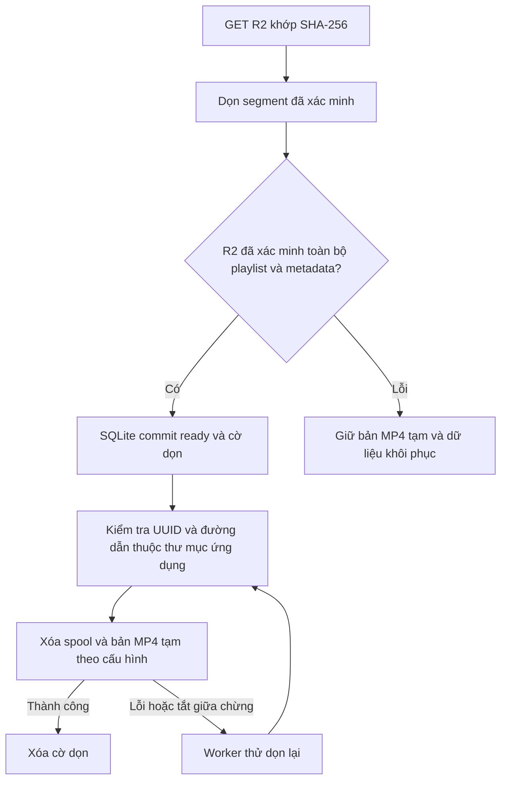

# Dọn media tạm và khôi phục

## Phase 08 Addition

Companion dùng lại spool, SHA-256 và receipt của Phase 07. Các segment đã xác minh rời spool sớm. Sau khi bộ HLS đạt trạng thái ready local, bản MP4 tạm và cờ dọn vẫn tồn tại cho tới khi Worker xác nhận D1 READY. `resume UUID` hoàn tất publication hoặc dọn tệp sau restart từ SQLite/receipt. Companion kiểm tra phạm vi đường dẫn trước khi xóa tệp tạm. Mã nguồn, DB, cấu hình và tệp của công việc khác nằm ngoài thao tác dọn.

Tệp MP4 gốc mặc định giữ nguyên. Việc chuyển vào Recycle Bin là lệnh đứng riêng với lựa chọn trước khi xử lý, mốc Admin xác nhận phát và tua online, so khóa D1, đối chiếu SHA-256 lẫn định danh tệp và xác nhận bằng chữ. Không suy ra đường dẫn nguồn từ tên tải lên. Xem [các bước xác nhận](LOCAL_PROCESSING.md#tùy-chọn-tệp-nguồn).

Phần còn lại mô tả cơ chế spool và khôi phục được tái sử dụng từ Phase 07.




Một lần phân mảnh có marker mang UUID cùng prefix R2 của nó. Nếu tiến trình chết trước receipt, worker khởi động lại đưa job processing về uploaded. Nó xóa object thuộc prefix riêng của lần cũ sau khi kiểm tra playlist cuối chưa có, rồi chạy lại từ MP4 của ứng dụng. Nếu đã có receipt, init, các segment và metadata đã được xác minh. Worker tiếp tục xác minh hoặc upload playlist, commit SQLite rồi dọn các tệp còn lại. Lỗi rõ ràng chuyển job thành failed. Sau khi xử lý nguyên nhân, thử lại cùng bucket và endpoint.

```powershell
.\.venv\Scripts\python.exe -m backend.storage.r2_storage retry <video-uuid>
```

Job mới mặc định xóa bản sao MP4 mà backend tạo. Tệp gốc do người dùng chọn nằm ngoài quy trình dọn. Code kiểm UUID, đường dẫn, symlink và junction ở các vị trí dọn. Nếu `KEEP_ORIGINAL_VIDEO=true`, backend giữ riêng bản MP4 tạm đã nhận để chẩn đoán. `DELETE_LOCAL_AFTER_VERIFICATION=false` giữ phần staging cuối khi streaming. Segment đã xác minh vẫn được dọn để spool không tăng theo toàn bộ video. Chế độ batch tương thích dùng thêm `DELETE_LOCAL_AFTER_UPLOAD` cho bộ HLS đầy đủ. Dọn ở Phase 07 áp dụng cho job mới, job được chạy lại hoặc bản ghi có cờ dọn từ trước.
