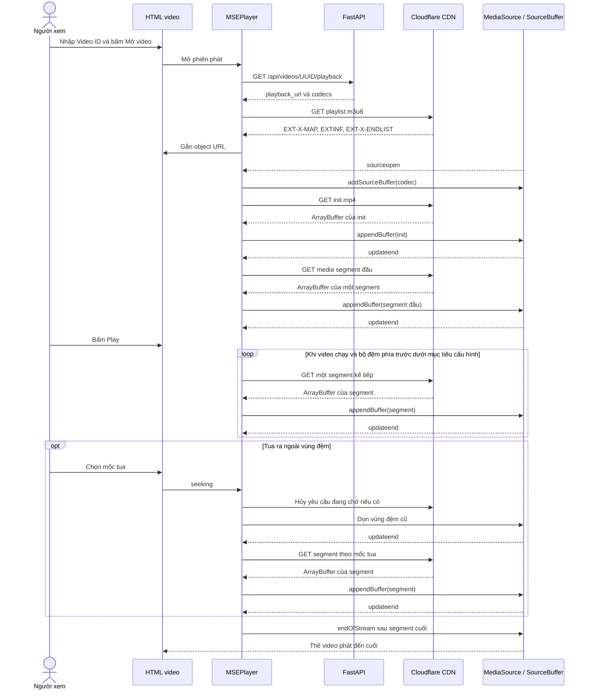

# Phát HLS fMP4 bằng JavaScript và MSE

Mở trang gốc FastAPI, nhập Video ID và bấm **Mở video**. Khi phân đoạn đầu đã sẵn sàng, dùng các nút **Play**, **Pause** và thanh tua trên thẻ video. Upload mới sẽ điền Video ID từ API vào ô nhập khi video đã sẵn sàng. Liên kết có dạng `/?video=<uuid>` nạp trước phân đoạn đầu và đợi người xem bấm Play. Ví dụ dùng [video Phase 04](http://localhost:8000/?video=ee3e7935-4b66-492d-a7f5-f937fb4be8f1).

## Nguồn dữ liệu

Trình phát gọi `GET /api/videos/<uuid>/playback` trên FastAPI. Với video `ready` đã xuất bản R2, API cung cấp `playback_url` và chuỗi codec thực của `init.mp4`. Khi CDN đã cấu hình, Fetch lấy playlist và các tệp media trực tiếp từ hostname CDN. URL tương đối trong playlist được phân giải theo URL playlist cuối cùng, kể cả khi Fetch theo redirect. Với bucket riêng, URL phát có thể là route FastAPI đọc R2 cùng origin.

Phạm vi trình phát là một media playlist VOD fMP4 do pipeline dự án sinh ra, mỗi phân đoạn có URI riêng, một init segment dùng chung, H.264 và AAC-LC nếu có audio. `#EXTINF` lập chỉ mục timeline cho thao tác tua, `#EXT-X-MAP` chỉ init segment và `#EXT-X-ENDLIST` cho biết danh sách đã kết thúc. Timestamp nhúng trong fMP4 quyết định thời điểm giải mã và hiển thị thực tế. [RFC 8216](https://datatracker.ietf.org/doc/html/rfc8216#section-4) · [W3C ISO BMFF byte stream](https://www.w3.org/TR/mse-byte-stream-format-isobmff/).

## API trình duyệt

| API hoặc sự kiện | Vai trò |
| --- | --- |
| `fetch()` | Gửi HTTP GET với tín hiệu hủy. Nếu máy chủ trả như 404 hay 503, Fetch vẫn có thể trả về một `Response`, vì vậy mã kiểm tra `response.ok`. Chính sách CORS của CDN cho phép trang localhost đọc nội dung phản hồi. |
| `response.arrayBuffer()` | Đọc toàn bộ byte của **một init segment hoặc một media segment**. Playlist dùng `text()`, còn trạng thái từ backend dùng `json()`. |
| `Uint8Array` | Tạo view để đọc byte từ 0 đến 255. Trình phát nhìn bốn byte tên box tại offset 4 bằng view trên buffer tải về. |
| `slice()` | `Blob.slice(start, end)` giới hạn phần cần đọc từ tệp. `ArrayBuffer.slice()` và `Uint8Array.slice()` tạo bản sao của vùng được chọn. Offset bắt đầu từ 0, mốc `end` là biên loại trừ. `Uint8Array.subarray()` tạo view chung lên cùng buffer. |
| `MediaSource` | Đối tượng MSE gắn vào thẻ video qua object URL. Trình phát kiểm tra `MediaSource.isTypeSupported()` bằng đúng codec backend cung cấp. |
| `sourceopen` | Báo MediaSource đã gắn và có thể thêm SourceBuffer. Trình phát đăng ký listener trước khi đặt `video.src`. |
| `SourceBuffer` | Giữ coded frame trình duyệt đã phân tích từ fMP4 và báo các vùng đã đệm bằng `buffered`. Dự án dùng một buffer cho media audio/video đã mux cùng nhau. |
| `appendBuffer()` | Gửi byte fMP4 vào SourceBuffer. Thứ tự khởi tạo là init, sau đó là media segment. Trình duyệt thực hiện phân tích bất đồng bộ. |
| `updateend` | Báo thao tác append hoặc remove đã kết thúc. Player chỉ thực hiện một thay đổi SourceBuffer mỗi lần và bắt sự kiện `error` hoặc `abort` để phân biệt thất bại. |
| `endOfStream()` | Báo MediaSource đã nhận tới hết playlist trong lượt nạp hiện tại. Gọi sau `updateend` của phân đoạn cuối. Khi người xem tua về vùng đã dọn, SourceBuffer có thể mở lại MediaSource trong lúc nạp phân đoạn tương ứng. |

[WHATWG Fetch](https://fetch.spec.whatwg.org/) · [W3C File API](https://www.w3.org/TR/FileAPI/) · [ECMAScript TypedArray](https://tc39.es/ecma262/multipage/indexed-collections.html) · [W3C Media Source Extensions](https://www.w3.org/TR/media-source-2/).

## Thứ tự tải và quản lý bộ đệm



- Khi mở video, ứng dụng chỉ nạp playlist, init và media segment đầu. Khi đang phát, nó lấy tối đa một segment mỗi lượt để giữ mục tiêu mặc định 60 giây phía trước. Segment đang append có thể đưa tổng thời gian đệm vượt mục tiêu thêm một segment.
- Ứng dụng loại bỏ vùng cũ theo biên segment, với mục tiêu mặc định 30 giây phía sau. API playback truyền cả hai mục tiêu. Trình phát giảm chúng theo bitrate quan sát được trên mỗi segment và mức ngân sách 48 MiB ước tính cho byte media nén. Nếu gặp QuotaExceededError, trình phát giảm cửa sổ, dọn về biên segment và thử append lại. Nếu video vẫn còn dữ liệu để phát, nó giữ tối đa một segment đang chờ và đợi vị trí phát tiến lên trước khi thử lại. Các mốc giới hạn độ dài vùng đệm, còn số segment và độ dài video do playlist quyết định.
- Tua trong vùng đệm có thể dùng dữ liệu sẵn có. Tua xa hủy fetch cũ, chờ thao tác SourceBuffer hiện tại, bỏ vùng đệm cũ rồi nạp từ segment chứa mốc tua hoặc segment liền trước khi gần mép. Các segment vẫn vào SourceBuffer theo thứ tự, dùng timestamp vốn có.
- Pause ngừng nạp trước sau segment đang xử lý. Tua khi pause vẫn có thể lấy đoạn đích. Phát lại sau khi kết thúc sẽ nạp lại đoạn đầu nếu phần đầu đã bị đẩy khỏi bộ đệm.
- Lỗi kết nối, timeout, HTTP 408, 429 và 5xx có hai lượt thử lại với thời gian chờ tăng dần. Khi playlist, init hoặc media trả HTTP 401/403, trình phát gọi lại API playback, tải lại playlist của cùng object key và kiểm tra timeline trước khi thử lại đúng một lần. Lỗi thường trực hoặc hết lượt thử hiển thị trong trang. Nút **Mở video** bắt đầu phiên mới và giải phóng object URL của phiên cũ.

## Lab nhị phân cục bộ

`admin/js/binary-lab.js` nhận một `Blob` HLSLAB v1 và đọc header 52 byte. `DataView` đọc kích thước 64 bit tại offset 12, còn `ArrayBuffer.slice(20, 52)` sao chép riêng vùng digest. `readLabBytes(blob, offset, count)` đọc một cửa sổ tối đa 64 KiB từ offset chỉ định. Hai hàm hoạt động cục bộ với Blob người gọi cung cấp. Quy trình MSE phát media fMP4 chuẩn và không gọi các hàm lab. [Định dạng HLSLAB](BINARY_PROCESSING.md).

## Chạy trên PowerShell

Từ thư mục gốc repository với môi trường ảo Phase 04, chạy FastAPI rồi mở trang video. Nếu FastAPI đang chạy, tải lại trang để nạp các module mới.

```powershell
.\.venv\Scripts\python.exe -m uvicorn backend.main:app --host 127.0.0.1 --port 8000
Start-Process 'http://localhost:8000/?video=ee3e7935-4b66-492d-a7f5-f937fb4be8f1'
```

Chạy hai lệnh ở hai cửa sổ PowerShell, hoặc mở liên kết sau khi Uvicorn báo đã sẵn sàng. Dùng Edge hoặc Chrome có hỗ trợ codec mà API trả về.

`tests/mse_smoke.mjs` dùng Node.js và Playwright để kiểm thử Edge. Bộ kiểm thử dùng video CDN thật cho CORS, phát và phát lại. Fixture FFmpeg dài 48 giây dùng cho tua xa, bộ đệm và lỗi giả lập. Chạy từ thư mục gốc trong cửa sổ khác khi FastAPI đang chạy. Các lệnh này đặt Playwright và fixture trong thư mục tạm.

```powershell
$testRoot = Join-Path $env:TEMP ('hls-mse-' + [guid]::NewGuid().ToString('N'))
$fixture = Join-Path $testRoot 'fixture'
New-Item -ItemType Directory -Path $fixture | Out-Null
npm install --prefix $testRoot --no-save --no-package-lock playwright
$env:PHASE05_PLAYWRIGHT = Join-Path $testRoot 'node_modules\playwright'
Push-Location $fixture
try {
    ffmpeg -v error -nostdin -f lavfi -i 'testsrc2=size=160x90:rate=10' -t 48 -c:v libx264 -preset ultrafast -pix_fmt yuv420p -force_key_frames 'expr:gte(t,n_forced*4)' -sc_threshold 0 -f hls -hls_time 4 -hls_list_size 0 -hls_playlist_type vod -hls_segment_type fmp4 -hls_flags independent_segments -hls_fmp4_init_filename init.mp4 -hls_segment_filename 'seg_%06d.m4s' playlist.m3u8
} finally {
    Pop-Location
}
$env:PHASE05_FIXTURE = $fixture
$codec = & .\.venv\Scripts\python.exe -B -c 'import os; from pathlib import Path; from backend.processing.ffprobe import probe_hls_codecs; print(probe_hls_codecs("ffprobe", Path(os.environ["PHASE05_FIXTURE"]) / "init.mp4"))'
node .\tests\mse_smoke.mjs $fixture $codec
```

`PHASE05_VIDEO_ID` cho phép dùng Video ID khác có URL CDN và video mẫu dài khoảng 9,2 giây. Giữ origin là `http://localhost:8000` hoặc đặt `PHASE05_ORIGIN` thành origin đã được phép trong CORS của bucket.
